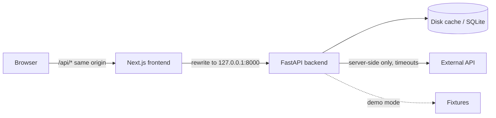

# Documentation templates

Part of [write-docs](SKILL.md). Replace `<...>`; delete sections that do not apply. Every command block ends with a
"checked" or "not verified" line.

## README.md

````markdown
# <App name>

<One sentence: who it is for and what they can do with it.>

   <!-- only a real, current screenshot -->

## Quick start (offline demo)
Needs: Node <version from package.json "engines">, Python <supported range>, git.
1. `git clone <repository URL>` and `cd <folder>`
2. `npm ci`
3. `npm run setup`: installs everything into this folder (backend `.venv`, frontend packages, test browser).
4. `npm run demo`, then open http://localhost:3000.
_Checked <date> on <OS>, Node <v>, Python <v>._

## Other commands
| Command | What it does |
|---|---|
| `npm run dev` | runs the app with your `.env` settings |
| `npm run verify` | all checks: lint, types, tests, build, browser smoke test |

## Settings
Copy `.env.example` to `.env` and fill in your own values. Never commit `.env`.
| Name | Required? | What it does |
|---|---|---|
| `<NAME>` | no | <purpose; default; what happens if unset> |

## Where things live
- `<frontendDir>/`: the website (Next.js)
- `<backendDir>/`: the API (FastAPI)
- `<docsDir>/`: product, architecture, acceptance, plan

## Known limitations
- <copied from <docs>/plan.md, with workaround>

More: [Setup and troubleshooting](docs/SETUP.md) · [Architecture](docs/ARCHITECTURE.md) · [Changelog](docs/CHANGELOG.md)
````

## SETUP.md sections

1. **Supported versions** (from `package.json` engines and the setup script's Python range) and how to check
   them: `node --version`, `python3 --version` (Windows: `py -0p` lists installed Pythons).
2. **Install**: `npm ci`, `npm run setup`; what success looks like; `APP_PYTHON=/path/to/python3.12 npm run setup`
   to choose a Python.
3. **Run**: `npm run dev` (live settings) vs `npm run demo` (offline example data), URLs, how to stop.
4. **Test**: `npm run verify`; what each stage means; where Playwright screenshots/reports go.
5. **Settings**: names table (as in the README), never values.
6. **Switching versions**: stop services → `git status` → commit or stash → `git switch ...` → `npm ci` →
   `npm run setup` (see the `git-collaboration` skill).
7. **Troubleshooting** table (below).

## Troubleshooting table

Use the **exact** error text the reader will see, copied from a real run.

| You see | Why | Fix |
|---|---|---|
| `Port 8000 is already in use` (copy the launcher's real wording) | another program uses the port | stop it, or `BACKEND_PORT=8001 npm run dev` |
| `npm ERR! ... npm ci can only install packages when your package.json and package-lock.json are in sync` | lockfile out of date | ask the owner of the change; do not delete the lockfile |
| `No supported Python found` (real wording) | Python missing or too new/old | install a supported version, or set `APP_PYTHON` |
| Blank page, terminal shows a build error | code error | read the first error line; use the `debug-issue` skill |

## CHANGELOG.md

```markdown
# Changelog
## <version or tag> — <YYYY-MM-DD>
### Added
- CSV export of the results table (criteria A4.1–A4.3).
### Fixed
- Empty chart when a period had no data now shows "No data" instead of 0.
### Verified
- `npm run verify` exit 0 on <commit short sha>; browser smoke at 1366 and 390 px.
### Known limitations
- Live mode not verified without an API key.
```
Only things that are in the code at that version. "Not verified" stays visible until it is verified.

## Architecture diagram (Mermaid, renders on GitHub)

````markdown

````
Draw only boxes that exist in the code. Below the diagram: one line per box saying which folder implements it,
and which secrets stay on the server.

## Teaching notes (TEACHING-GUIDE.md)

- **Rehearsal (10 min):** exact commands from a fresh clone to the demo, with expected output.
- **Three-minute demo per version:** checkout command, what to click, what to point out.
- **Skills and agents used** for each part (link to `.claude/skills/INDEX.md`).
- **Exercises:** a starting ref, a goal, the acceptance check (for example "`npm run verify` passes and the new
  button downloads 12 rows").
- **Known limitations** and what is not verified.
- If a cleaned-up replay prompt is offered, label it "edited teaching material", separate from the recorded prompts.
